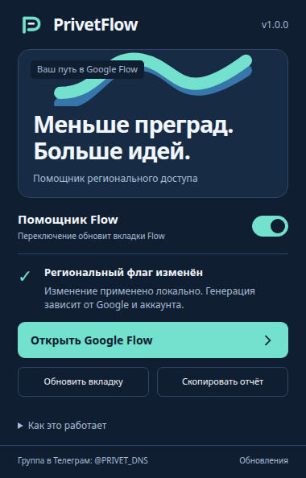

# PrivetFlow

**Меньше преград. Больше идей.**

Расширение для Chrome и совместимых Chromium-браузеров, которое помогает с сообщением о недоступности Google Flow в вашем регионе. Работает локально, имеет русский интерфейс, переключатель и диагностику. Не требует своего аккаунта или сервера.

[Скачать последнюю версию](https://github.com/privettisha/PrivetFlow/releases/latest)



## Установка

1. Откройте [релизы](https://github.com/privettisha/PrivetFlow/releases/latest) и скачайте **PrivetFlow-v1.0.0-Chrome.zip** из раздела Assets. Архивы **Source code** предназначены для разработчиков.
2. Распакуйте ZIP в постоянную папку. Не удаляйте и не перемещайте её после установки.
3. В Chrome откройте `chrome://extensions`. В Edge — `edge://extensions`.
4. Включите **Режим разработчика**.
5. Нажмите **Загрузить распакованное расширение** и выберите папку, в которой находится `manifest.json`.
6. Закрепите PrivetFlow на панели расширений. Откройте его и нажмите **Открыть Google Flow**.
7. Если Flow уже был открыт, нажмите **Обновить вкладку**. Войдите в свой Google-аккаунт обычным способом.

Требуется Chrome 111+ либо совместимый Chromium-браузер. Автоматически проверен Chromium; Edge, Brave и другие браузеры отдельно не тестировались. Этот ZIP не предназначен для Firefox или мобильного Chrome.

## Что умеет

- Включение и выключение с сохранением выбора между запусками браузера. Переключение перезагружает открытые вкладки Flow: сначала сохраните работу.
- Открытие существующей вкладки Flow без лишних дублей.
- Обработка известных региональных ответов через `fetch`, `XMLHttpRequest` и разбор JSON-кадров.
- Проверка структуры данных перед изменением. Неизвестные ответы остаются без изменений.
- Локальный статус и копирование короткого диагностического отчёта без промптов, токенов, cookies и адресов проектов.
- Работа только на `https://flow.google.com/`, без аналитики, внешних правил и загрузки исполняемого кода.

## Как работает

При включении расширение регистрирует локальный скрипт на самом раннем этапе загрузки Flow. Скрипт распознаёт конфигурационный RPC `cPZSdc` и корректирует известное поле региональной доступности (индекс 30), когда структура ответа соответствует ожидаемой и соседний флаг возрастного допуска разрешён. Возрастной флаг не меняется.

Для известных REST/tRPC-проверок исправляются явно обозначенные региональные ограничения. Ошибки сервера, ограничения возраста, подписки и квот не превращаются в успешные ответы. Успешные ответы `fetch` читаются через копию; исходный ответ остаётся доступен при ошибке обработки. Сохраняются HTTP-статус, URL и поведение чтения тела; длины изменённых RPC-кадров пересчитываются. Дополнительный обработчик `JSON.parse` распознаёт только известные конфигурационные кадры и помогает при потоковом чтении.

PrivetFlow не меняет IP, страну аккаунта, баланс кредитов или подписку. Он не гарантирует доступ и успешную генерацию, если Google проверяет ограничения на сервере. Это независимый проект, не связанный с Google.

## Статусы и помощь

| Статус | Значение и действие |
| --- | --- |
| Откройте Google Flow | В текущем окне нет вкладки Flow. Нажмите основную кнопку. |
| Ожидаем ответ Flow | Скрипт запущен, известный ответ ещё не получен. Дождитесь загрузки. |
| Региональный флаг изменён | Подтверждено локальное изменение данных. Это не проверка генерации. |
| Регион уже доступен | Получен разрешённый региональный флаг. |
| Обновите вкладку Flow | Текущая страница загрузилась без помощника. Обновите её. |
| Есть другое ограничение | Обнаружено ограничение, которое расширение не изменяет. Проверьте аккаунт в Flow. |
| Формат ответа не распознан | Google мог изменить формат. Проверьте новую версию. |

Если осталась страница недоступности, откройте [главную страницу Flow](https://flow.google.com/) вручную. Если возникают 401/403, ошибки сети или генерации, они требуют отдельной проверки входа, аккаунта и подключения: локальный статус не доказывает их устранение. При диагностике отключите другие расширения, изменяющие Flow, обновите вкладку и скопируйте отчёт из панели PrivetFlow.

## Обновление и удаление

Распакованная версия **не обновляется автоматически**. Скачайте новый ZIP из релизов, закройте вкладки Flow, замените содержимое папки расширения и нажмите кнопку обновления на `chrome://extensions`. Снова откройте Flow.

Чтобы полностью остановить помощник, выключите его в панели (вкладки Flow перезагрузятся). Для удаления нажмите **Удалить** на странице расширений и обновите оставшиеся вкладки Flow.

## Разрешения и приватность

`storage` сохраняет только переключатель. `scripting` подключает помощник и считывает локальный статус. Доступ к сайту ограничен `https://flow.google.com/*`. Отчёт копируется только по нажатию кнопки. Политика: [PRIVACY.md](PRIVACY.md).

## Разработка и проверки

Установка из исходников: выберите папку `extension` на странице расширений.

```sh
npm ci
npm test
npx playwright install chromium
npm run test:browser
npm run build
```

Node.js 22+, Python 3 для упаковки. Во время обычной работы расширение не требует Node.js, Python или npm. ZIP и SHA256 находятся в `dist/`. Иконки и интерфейс входят в репозиторий, сборщик JavaScript не нужен.

Модульные тесты проверяют региональные флаги, возрастные ограничения, неизвестные схемы, Unicode и RPC-кадры. Браузерный тест загружает настоящее MV3-расширение в Chromium, проверяет сетевые перехватчики, панель и переключатель на искусственных ответах. **Генерация на реальном Google-аккаунте не проверена.**

Лицензия: [MIT](LICENSE).

**Группа в Телеграм: @PRIVET\_DNS**
